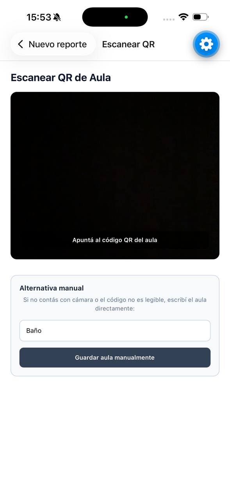
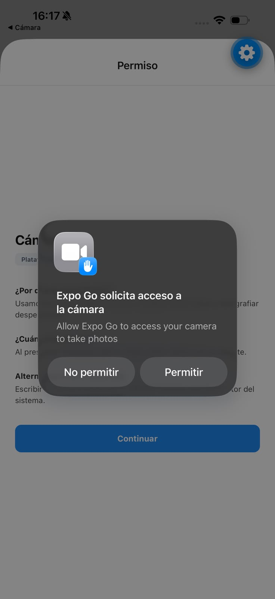
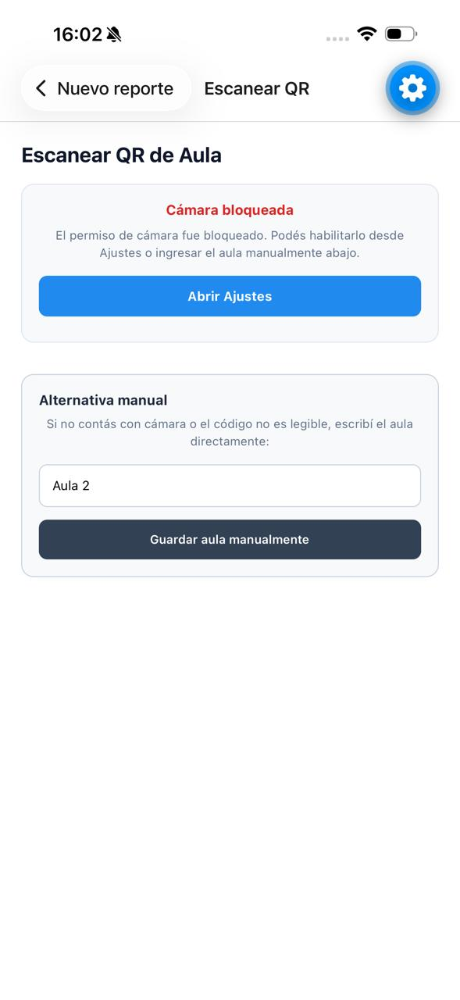
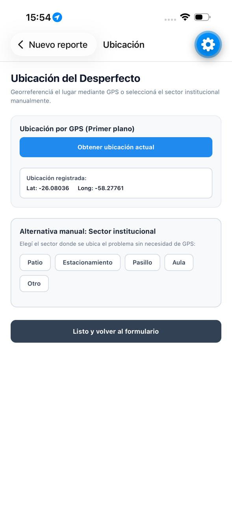
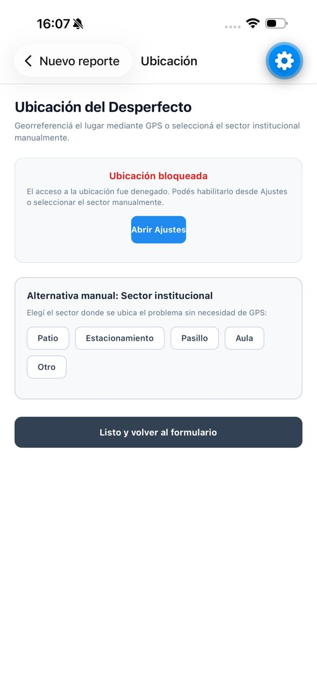
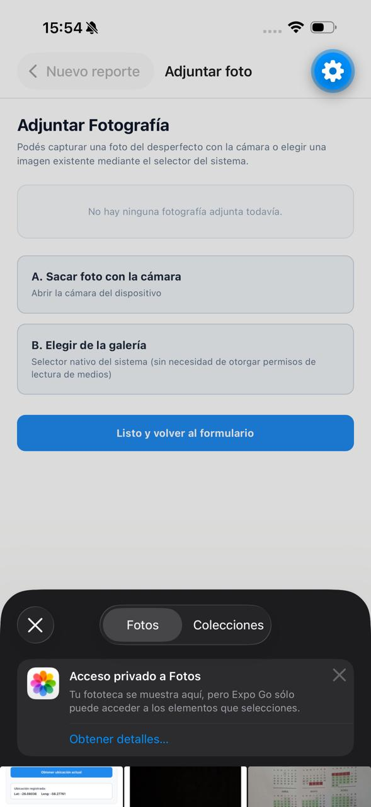
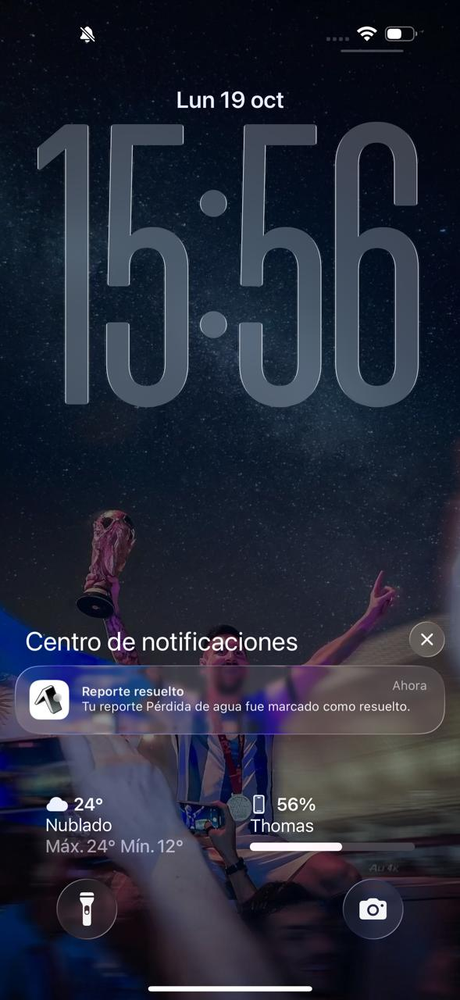
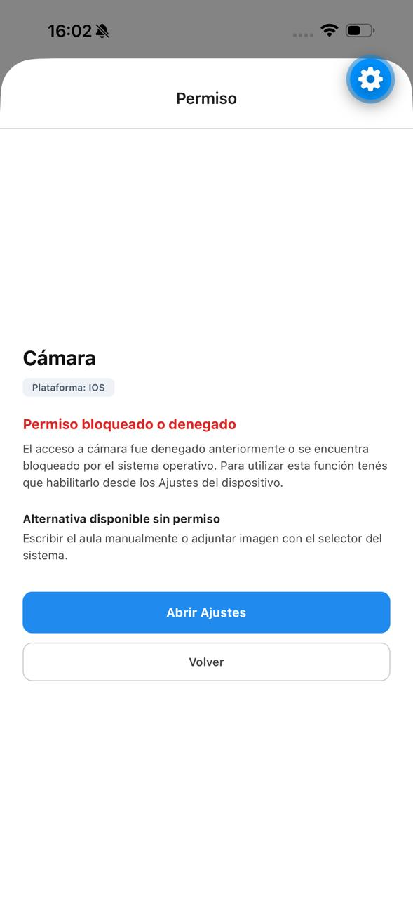
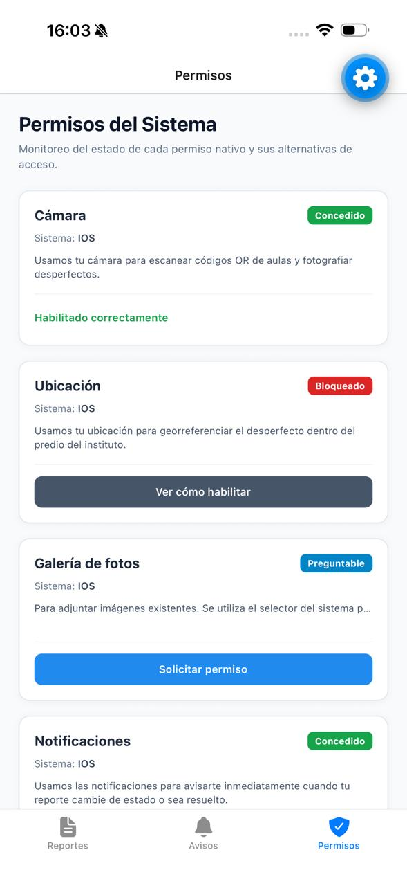

# Mantenimiento IPF

Aplicación para reportar desperfectos del instituto y recibir avisos cuando se resuelven. Desarrollada para el Trabajo Práctico N° 3 de Taller Complementario – React Native II en el Instituto Politécnico Formosa.

---

## Tecnologías

- Expo SDK 57
- React Native
- TypeScript
- Expo Router
- expo-camera
- expo-location
- expo-image-picker
- expo-notifications

---

## Instalación

1. Clonar el repositorio y posicionarse en la carpeta raíz del proyecto.
2. Instalar las dependencias del proyecto:
   ```bash
   npm install
   ```
3. Iniciar el servidor de desarrollo de Expo:
   ```bash
   npx expo start
   ```

> **Aclaración**: El directorio `node_modules/` no se versiona en el repositorio (se encuentra excluido mediante `.gitignore`).

---

## Estructura del proyecto

Árbol real de rutas en `src/app`:

```text
src/app/
  _layout.tsx
  ajustes-app.tsx
  (tabs)/
    _layout.tsx
    avisos.tsx
    index.tsx
    permisos.tsx
  permisos/
    [recurso].tsx
  reporte/
    [id].tsx
    escanear.tsx
    foto.tsx
    nuevo.tsx
    ubicacion.tsx
```

---

## Rutas

- `/`: Lista principal de reportes de mantenimiento propios con su estado (`pendiente`, `en curso`, `resuelto`) y acceso al formulario de nuevo reporte.
- `/reporte/nuevo`: Formulario para crear un reporte (título, descripción, aula, categoría y botones para escanear QR, adjuntar foto o marcar ubicación). No solicita ningún permiso al ingresar.
- `/reporte/escanear`: Permite escanear el código QR del aula utilizando la cámara o ingresar la identificación del aula de manera manual.
- `/reporte/foto`: Permite tomar una fotografía del desperfecto con la cámara o elegir una imagen existente mediante el selector del sistema (*Photo Picker*).
- `/reporte/ubicacion`: Permite georreferenciar el problema con las coordenadas GPS actuales o seleccionar manualmente el sector institucional (Patio, Pasillo, Estacionamiento, Aula u Otro).
- `/reporte/[id]`: Visualización detallada del reporte, foto adjunta, ubicación registrada o sector manual, con botón de prueba "Simular resolución".
- `/avisos`: Bandeja interna de avisos y novedades dentro de la app, que actúa como alternativa cuando las notificaciones están desactivadas o denegadas.
- `/permisos`: Panel de control general que muestra el estado de cada recurso (`concedido`, `preguntable`, `bloqueado`, `parcial`) y permite solicitar o abrir Ajustes.
- `/permisos/[recurso]`: Pantalla previa modal explicativa antes de disparar el diálogo del sistema, que detalla el beneficio concreto, cuándo se solicita y su alternativa.
- `/ajustes-app`: Pantalla de preferencias con el interruptor "Avisarme cuando se resuelva mi reporte" para activar o desactivar notificaciones locales.

---

## Permisos

| Recurso | Módulo | Cuándo se pide | Alternativa |
| --- | --- | --- | --- |
| **Cámara** | `expo-camera` | Al presionar "Escanear QR" o "Sacar foto con la cámara" | Ingresar aula manualmente por teclado o adjuntar imagen con el selector del sistema |
| **Ubicación** | `expo-location` | Al presionar "Obtener ubicación actual" en el formulario | Seleccionar el sector del instituto manualmente de una lista desplegable |
| **Fotos** | `expo-image-picker` | No se solicita permiso para elegir con el selector | Se utiliza el selector del sistema (*Photo Picker*), otorgando solo la imagen elegida |
| **Notificaciones** | `expo-notifications` | Únicamente al activar el interruptor "Avisarme cuando se resuelva mi reporte" | Consultar novedades en la bandeja interna `/avisos` |

---

## app.json

A continuación se muestra el bloque relevante de configuración de `plugins` y `blockedPermissions` en `app.json`:

```json
{
  "expo": {
    "android": {
      "blockedPermissions": [
        "android.permission.RECORD_AUDIO",
        "android.permission.ACCESS_BACKGROUND_LOCATION",
        "android.permission.READ_MEDIA_IMAGES",
        "android.permission.READ_MEDIA_VIDEO"
      ]
    },
    "plugins": [
      "expo-router",
      [
        "expo-camera",
        {
          "cameraPermission": "Usamos tu cámara para escanear códigos QR de aulas y fotografiar desperfectos",
          "microphonePermission": false,
          "recordAudioAndroid": false
        }
      ],
      [
        "expo-location",
        {
          "locationWhenInUsePermission": "Usamos tu ubicación para georreferenciar el desperfecto dentro del predio del instituto"
        }
      ],
      [
        "expo-image-picker",
        {
          "photosPermission": "Usamos tus fotos para adjuntar imágenes de desperfectos desde la galería",
          "microphonePermission": false
        }
      ],
      "expo-notifications"
    ]
  }
}
```

### Explicación de la configuración:

- **`expo-camera`**:
  - `cameraPermission`: Define el texto de propósito en iOS (`NSCameraUsageDescription`) explicando el beneficio concreto.
  - `microphonePermission: false`: Evita registrar y pedir acceso al micrófono en iOS.
  - `recordAudioAndroid: false`: Evita que el plugin agregue el permiso de grabación de audio en Android.
- **`expo-location`**:
  - `locationWhenInUsePermission`: Configura en iOS `NSLocationWhenInUseUsageDescription` para solicitar únicamente ubicación mientras la aplicación está en uso en primer plano.
- **`expo-image-picker`**:
  - Se utiliza mediante el selector del sistema (*Photo Picker* nativo).
  - No se pide permiso general de almacenamiento ni lectura de galería completa al usuario para elegir una foto.
- **`expo-notifications`**:
  - Registrado en plugins para dar soporte a notificaciones locales y gestión de canales en Android.
- **`blockedPermissions`**:
  - `android.permission.RECORD_AUDIO`: Porque la aplicación no graba audio ni notas de voz.
  - `android.permission.ACCESS_BACKGROUND_LOCATION`: Porque la georreferenciación se realiza exclusivamente en primer plano al crear el reporte.
  - `android.permission.READ_MEDIA_IMAGES`: Porque la app utiliza el selector del sistema y no necesita leer la biblioteca completa de imágenes del dispositivo.
  - `android.permission.READ_MEDIA_VIDEO`: Porque la app no necesita acceder a videos del usuario.

### Principio de mínimo privilegio:
El principio de mínimo privilegio (*Principle of Least Privilege*) establece que una aplicación debe solicitar únicamente los permisos estrictamente necesarios para cumplir las funciones que el usuario demandó, en el nivel de acceso más acotado posible (por ejemplo, ubicación en uso en vez de siempre; selector del sistema en vez de acceso a toda la galería). Al excluir permisos innecesarios mediante `blockedPermissions` y flags de plugins, se protege la privacidad de la persona, se reduce la superficie de ataque y se garantiza el cumplimiento de las políticas de Google Play y App Store.

---

## Flujo de permisos

El hook unificado `usePermiso(recurso)` administra el ciclo de vida del permiso a través de cuatro estados claros:

- **`cargando`**: Estado inicial mientras se realiza la consulta asíncrona ante el sistema operativo. La interfaz muestra un indicador de carga para evitar parpadeos o decisiones prematuras.
- **`concedido`**: El usuario autorizó el acceso al recurso. La pantalla correspondiente se habilita para operar con normalidad.
- **`preguntable`**: El permiso no fue decidido aún o fue rechazado una primera vez en Android (`canAskAgain: true`). La app presenta la pantalla previa contextual con el botón "Continuar".
- **`bloqueado`**: El permiso fue denegado definitivamente (`canAskAgain: false`) o bloqueado por el sistema. La app no muestra diálogos nativos inútiles; en su lugar, informa el bloqueo, ofrece el botón "Abrir Ajustes" y despliega la alternativa manual.

### Elementos clave del hook:
- **`parcial`**: Booleano que indica restricciones de acceso (ubicación aproximada en Android/iOS o acceso limitado a fotos en iOS).
- **`pedir()`**: Función asíncrona que invoca la solicitud nativa del sistema operativo mostrando el diálogo si el estado es preguntable.
- **`consultar()`**: Función asíncrona que verifica el estado actual registrado en el sistema operativo sin desplegar diálogos.
- **`abrirAjustes()`**: Deriva a la persona usuaria a los Ajustes de la aplicación mediante `Linking.openSettings()`.
- **`AppState`**: El hook escucha las transiciones de estado de la app mediante `AppState.addEventListener('change')`. Cuando el usuario regresa de la pantalla de Ajustes del sistema y la app vuelve a estar activa (`active`), se ejecuta automáticamente `consultar()` para sincronizar el estado en pantalla sin requerir reinicios.

---

## Notificaciones

- **Solicitud en contexto**: El permiso de notificaciones nunca se solicita al abrir la app; se pide únicamente cuando la persona activa conscientemente el interruptor en `/ajustes-app`.
- **Canal en Android**: Antes de solicitar el permiso o programar avisos en Android, se crea y asegura el canal `"reportes"` con prioridad alta mediante `Notifications.setNotificationChannelAsync('reportes', ...)`.
- **Simulación de resolución**: Al presionar "Simular resolución" en `/reporte/[id]`:
  - Se actualiza el estado del reporte a "resuelto".
  - Se genera un aviso interno en memoria dentro del contexto de la aplicación (`React Context`), quedando disponible en `/avisos` durante la sesión de la aplicación.
  - Si el interruptor de notificaciones está encendido y el permiso concedido, se programa una notificación local que se dispara a los 10 segundos.
- **Bandeja interna de respaldo**: Si las notificaciones se encuentran desactivadas o denegadas, el aviso queda disponible en `/avisos` durante la sesión de la aplicación, garantizando que la persona no pierda información relevante.

---

## Expo Go y Development Build

- **Expo Go**: Resulta de gran utilidad para el desarrollo ágil de la interfaz de usuario, navegación, lógica de formularios, captura con selector y pruebas preliminares. Sin embargo, su binario nativo ya viene precompilado con un manifiesto fijo y textos genéricos de Expo.
- **Development Build**: Los textos de propósito propios redactados en `app.json`, las directivas de exclusión de `blockedPermissions` y el comportamiento fidedigno de los diálogos nativos del sistema solo pueden auditarse y verificarse en una *development build* (o compilación nativa instalada mediante `npx expo run:android` / EAS Build).
- **Verificación**: Para dar por completo el ciclo de auditoría móvil, la aplicación debe probarse en al menos una *development build* nativa donde se inspeccione el manifiesto compilado y la respuesta del sistema operativo real.

---

## Evidencias

A continuación se disponen los marcadores de evidencia visual para documentar el funcionamiento en dispositivo:

### Escáner - cargando
> Evidencia no incluida en esta entrega.

### Escáner - concedido


### Escáner - preguntable


### Escáner - bloqueado


### Ubicación concedida


### Ubicación denegada / sector manual


### Foto desde selector del sistema


### Notificación recibida


### Panel de permisos antes de Ajustes


### Panel de permisos después de Ajustes


### Diálogo del sistema en development build
> Evidencia no incluida en esta entrega.
